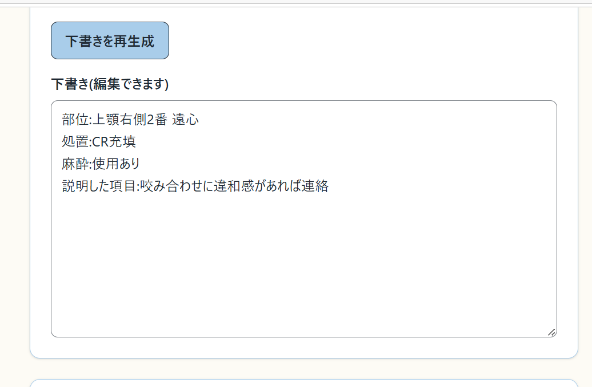

# CR処置後の記録補助ツール(講座用デモ)

> **講座用デモ・架空の情報のみ入力してください。** 実在の患者・処置の情報は入力しないでください。

## 概要

CR(コンポジットレジン)処置後の記録を補助する、講座課題用のデモツールです。

選択式の入力から、定型文で記録の下書きを組み立てます。入力していない項目・確認が必要な項目を一覧で表示し、下書きを確認・修正してからコピーできます。

下書きは入力値を決まった順に並べるだけの処理で、AI による文章の生成や、医学的な内容の補完は行いません。入力していない事実(「異常なし」「説明済み」など)を自動で追加することもありません。

## 対象ユーザー

CR処置後の記録を入力する歯科医師・スタッフ(講座での利用を想定したデモ)。

## 機能

トップページ `/` の1画面で、上から順に操作します。

| ID | 機能 | 内容 |
|---|---|---|
| F-01 | 部位入力 | 上顎・下顎、右・左、歯の番号(1〜8)、歯面(複数選択)。歯面の名称は歯の位置で切り替わる(前歯は切縁・唇側、臼歯は咬合面・頬側、内側は上顎が口蓋側・下顎が舌側) |
| F-02 | 処置入力 | 処置内容8項目(複数選択)と補足、麻酔(使用あり・使用なし・未確認)、麻酔の詳細(使用ありのときだけ表示)、使用材料、色調 |
| F-03 | 説明・予定入力 | 患者に説明した項目5つ(複数選択)と補足、次回予定、その他の所見・補足 |
| F-04 | 未入力確認 | 「必須項目の未入力」「確認してください」「任意項目の未入力」の3グループを入力に応じて表示 |
| F-05 | 下書き生成 | 必須項目(歯の位置と処置内容)がそろえば生成。足りなければ生成せず、不足理由を表示 |
| F-06 | 下書き編集 | テキスト欄で手動編集。編集後の再生成では上書きの確認を表示。生成後に入力を変えると「古い下書き」と表示 |
| F-07 | コピー | 「下書きの内容を確認した」のチェック後にコピー。成功・失敗を表示し、失敗時は全文選択から手動でコピーできる |
| F-08 | 入力リセット | 確認のうえ、入力・下書き・確認チェック・コピー結果をすべて消去 |

入力の初期値はすべて未選択・空欄です。「未入力」「未確認」「なし」は別の状態として扱います。

## 技術スタック

| 分類 | 使用技術 |
|---|---|
| フレームワーク | Next.js 16.4.0(App Router・Turbopack) |
| UI | React 19.3.0 |
| 言語 | TypeScript 5.9 |
| スタイル | Tailwind CSS 4.3 |
| テスト | Vitest 5.0.3 |
| Lint | ESLint 9(eslint-config-next) |
| 公開先(予定) | Vercel |

ログイン・データベース・外部 API は使用していません。

## 起動方法

Node.js 22.12 以降が必要です(Node.js 24.19.0 で動作を確認しています)。

```bash
npm install
npm run dev
```

ブラウザで http://localhost:3000 を開きます。

その他のコマンドは次のとおりです。

```bash
npm run build   # 本番ビルド(型チェックを含む)
npm run start   # ビルド結果を起動(先に build が必要)
npm test        # 単体テスト(Vitest)
npm run lint    # ESLint
```

## デモの制約

- **架空の情報だけを入力してください。** 画面の最上部に「講座用デモ・架空の情報のみ入力してください」を常に表示しています。
- 患者名・生年月日・診察券番号の入力欄はありません。
- 入力と下書きは画面を開いている間だけ保持します。データベース・localStorage・sessionStorage・Cookie には保存せず、再読み込みや画面を閉じると消えます。
- 入力内容を外部 API やログに送信しません。
- 未入力・未確認の一覧は入力欄の空欄を示すもので、記録の医学的な完全性を保証するものではありません。
- 診断・治療方法の提案や、AI による医学的内容の補完は行いません。
- 対象は CR 処置1件分のみです。他の処置、テンプレートの調整、音声入力、電子カルテとの連携は対象外です。
- クリップボードへのコピーは https または localhost でのみ使えます。同じネットワークの別端末から http で開いた場合はコピーに失敗するため、画面の案内に沿って全文を選択して手動でコピーしてください。

## テスト結果

2026-10-14 時点の結果です。

| 確認 | 結果 |
|---|---|
| `npm test` | 14ファイル・158件すべて成功 |
| `npm run lint` | エラー・警告なし |
| `npm run build` | 成功 |

単体テストで確認している主な内容は次のとおりです。

- 入力していない項目の行を下書きに出さず、「異常なし」などの文言を補わない
- 麻酔の未入力・使用あり・使用なし・未確認を区別し、使用あり以外では詳細を下書きに出さない
- 歯の位置に応じて歯面の名称が切り替わる
- 必須項目が足りなければ生成せず、不足理由を返す
- 編集後の再生成で上書きの確認を出し、取り消せば編集内容を残す
- 下書きの編集・再生成・入力の変更で確認チェックを外す
- コピー中に内容が変わった場合やリセットした場合は、遅れて返った結果を表示しない

ブラウザでの手動確認(クリック操作、コピーと貼り付け、幅375pxの表示、再読み込みでの初期化など)の記録は [DEVLOG.md](DEVLOG.md) にあります。

## スクリーンショット

架空の入力から下書きを生成した画面です(下書きの欄の部分)。



## 公開URL

**未追加です。** Vercel への公開と GitHub リポジトリの公開は、まだ行っていません。

## 関連ドキュメント

- [requirements.md](requirements.md):要件定義書
- [CLAUDE.md](CLAUDE.md):開発の進め方と守るべき制約
- [DEVLOG.md](DEVLOG.md):開発中のつまずきと解決方法、手動確認の記録
